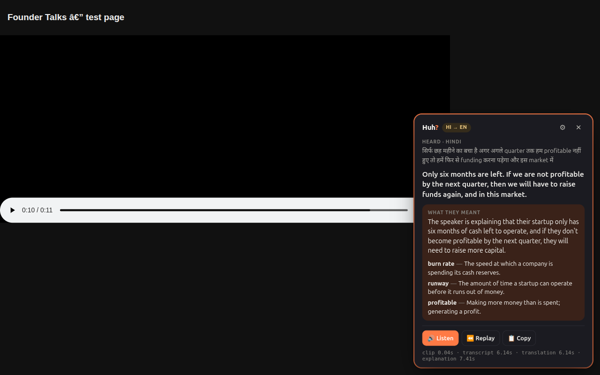

# Huh?

**Missed what was just said in a video? Press `Alt+H`.**

Huh? is a Chrome extension (Manifest V3). It takes the last ~12 seconds of a tab's audio, transcribes it with Sarvam AI, translates it into your language, explains it in plain words, and can read the explanation aloud. It works on YouTube, Vimeo, or any tab playing audio, in 22 Indian languages plus English.



<sub>Demo GIF goes here. The screenshot above is the real card, from an end-to-end run against the live Sarvam APIs: a Hindi/English code-mixed clip, explained in English.</sub>

## How it works

```
 ┌──────────────────────────── Chrome ─────────────────────────────┐
 │                                                                 │
 │  Video tab                         Offscreen document           │
 │  ┌───────────────────┐  tab audio  ┌──────────────────────────┐ │
 │  │ <video> ──────────┼────────────▶│ getUserMedia(tab stream) │ │
 │  │                   │             │  ├─▶ speakers (pass-thru)│ │
 │  │ content.ts        │             │  └─▶ AudioWorklet        │ │
 │  │  Shadow-DOM card  │             │      48k→16k mono        │ │
 │  │  pause / resume   │             │      25 s ring buffer    │ │
 │  └────────▲──────────┘             └───────────▲──────────────┘ │
 │           │ card updates                       │ last N s → WAV │
 │  ┌────────┴────────────────────────────────────┴─────────────┐  │
 │  │ background.ts (service worker)                            │  │
 │  │  Alt+H / toolbar → tabCapture → arm · trigger · orchestrate│ │
 │  └───────────────────────────┬───────────────────────────────┘  │
 └──────────────────────────────┼──────────────────────────────────┘
                                │ HTTPS (no API key in the extension)
                    ┌───────────▼────────────┐         ┌──────────────────────┐
                    │ server/ (Hono, Node)   │────────▶│ api.sarvam.ai        │
                    │ /api/transcribe        │         │ /speech-to-text      │
                    │ /api/translate         │         │ /translate           │
                    │ /api/explain           │         │ /v1/chat/completions │
                    │ /api/speak  /api/huh   │         │ /text-to-speech      │
                    └────────────────────────┘         └──────────────────────┘
```

1. **Arm.** On the first `Alt+H` press (or a toolbar click), the extension starts capturing that tab's audio into a 25-second in-memory buffer, and the badge shows **ON**. Audio is recorded continuously because there's no way to grab it after the fact.
2. **Trigger.** On the next press, the video pauses and the extension slices the last N seconds (5–25s, default 12) into a 16 kHz WAV. If the clip is silent, it stops there without calling any API.
3. The card fills in as each stage finishes: the **transcript** (original script, with a language chip), the **translation**, then the **explanation** with up to three tricky terms.
4. Card buttons are **🔊 Listen**, **⏪ Replay** (seek back N seconds and play), and **📋 Copy**. **✕** or `Esc` closes the card and resumes the video.

## Sarvam APIs used

| Step | Sarvam API | Endpoint | Model / settings | Called from |
|---|---|---|---|---|
| Transcribe | Speech-to-Text | `POST /speech-to-text` | `saaras:v4`, `mode=codemix`, `language_code=unknown`, `keyterms` from the video title | `/api/transcribe` |
| Speech→English (fast path) | Speech-to-Text | `POST /speech-to-text` | `saaras:v4`, `mode=translate` | `/api/transcribe` (when the target is `en-IN`) |
| Translate | Text Translate | `POST /translate` | `sarvam-translate:v1` (22 languages); `mayura:v1` for colloquial/code-mixed | `/api/translate` |
| Explain | Chat Completions | `POST /v1/chat/completions` | `sarvam-105b`, `reasoning_effort: null`, `json_schema` output | `/api/explain` |
| Read aloud | Text-to-Speech | `POST /text-to-speech` | `bulbul:v4-flash`, mp3, 24 kHz | `/api/speak` |

### Where we departed from the original spec (and why)

All of these were found by testing against the live API, and each has a comment in the code.

- **STT `mode=codemix` instead of `transcribe`.** With `language_code=unknown`, `saaras:v4` in `transcribe` mode misdetected Hindi/Hinglish speech as `en-IN` and returned it romanized. `codemix` detected `hi-IN` (p≈0.98), kept Devanagari, and left English words in English, which is how Indian videos are actually spoken. Tamil and English clips came out identical in both modes.
- **Mayura for code-mixed text.** `sarvam-translate:v1` consistently mistranslated code-mixed input. For example, "ये तो बेकार plan है" came back as an unrelated sentence. Mayura handled it correctly, so the server routes code-mixed text, colloquial styles, and unknown sources to `mayura:v1`. `sarvam-translate:v1` also rejects `source_language_code: "auto"`.
- **The explain prompt names the language** ("Hindi (hi-IN), in its native script"). With a bare `hi-IN`, the model kept answering in English.
- **`json_schema` instead of `json_object`.** This is what the docs recommend, and it works with reasoning disabled. The parse-retry-fallback path from the spec is still there.
- **TTS voices.** `bulbul:v4-flash` only accepts persona IDs (`simran_enhi_customer`, `shubh_en_narration`…). Plain names like `priya` return a 400. Opus also works on v4-flash; we use mp3 anyway.
- **English fast path.** It runs *alongside* the original-language transcript instead of replacing it, so the card always shows what was actually said.

## Setup

You need Node 20.12+, Chrome 116+, and a Sarvam API key from [dashboard.sarvam.ai](https://dashboard.sarvam.ai).

### 1. Server (holds your API key)

```bash
cd server
npm install
cp .env.example .env        # then paste your key: SARVAM_API_KEY=...
npm run dev                 # → http://localhost:8787
curl localhost:8787/health  # {"ok":true,"hasKey":true}
```

Set `ALLOWED_ORIGIN=chrome-extension://bcebelghhmjnjcjpipkkggepamhgmmji` in `.env`. The extension ID is pinned by the `key` in `manifest.json`, so it's the same on every machine. If you leave it unset, the server accepts any `chrome-extension://` origin, which is fine for local development.

The API key lives **only** in `server/.env`. The extension never sees it.

### 2. Extension

```bash
cd extension
npm install
npm run build               # → extension/dist
```

1. Open `chrome://extensions` and turn on **Developer mode**.
2. Click **Load unpacked** and pick `extension/dist`.
3. An onboarding tab opens. Choose your language in the settings (default: English).
4. Open a video and press **`Alt+H`** to start listening. After you miss something, press **`Alt+H`** again.

To change the shortcut, go to `chrome://extensions/shortcuts`. `npm run watch` rebuilds on every change.

### Settings

These are stored in `chrome.storage.sync`:
- **Target language:** any of the 22 Sarvam languages, plus English.
- **Translation style:** Formal (Sarvam-Translate), or Colloquial / Code-mixed (Mayura).
- **Clip length:** 5–25 seconds.
- **Voice:** a Bulbul v4 Flash persona, plus an auto-play toggle.
- **Backend URL.**
- **Developer mode:** shows per-stage timings on the card.

The 🔊 button is hidden for languages Bulbul doesn't speak. It supports 11: bn, en, gu, hi, kn, ml, mr, od, pa, ta, te.

## Server API

All routes are `POST`. Errors come back as `{ "error": { "code", "message" } }`.

| Route | Body | Returns |
|---|---|---|
| `/api/transcribe` | multipart: `audio` (WAV), `sourceLang?`, `mode?` (`transcribe`/`translate`/`codemix`), `keyterms?` (JSON array) | `{ transcript, detectedLang, languageProbability }` |
| `/api/translate` | `{ text, sourceLang?, targetLang, style? }` | `{ translatedText, sourceLang, model, skipped }` |
| `/api/explain` | `{ transcript, translation?, sourceLang?, targetLang, videoTitle?, pageUrl?, previousTranscript? }` | `{ explanation, terms: [{ term, meaning }] }` |
| `/api/speak` | `{ text, targetLang, speaker?, pace? }` | `{ audio: <base64 mp3>, mimeType }` |
| `/api/huh` | multipart: `audio`, `targetLang`, `style?`, `videoTitle?`, `pageUrl?`, `previousTranscript?` | Server-Sent Events: `transcript`, `translation`, `explanation`, `error`, `done` |

Every Sarvam call has a 15s timeout. Sarvam errors are mapped to friendly messages: a 422 means bad audio or a clip over 30s, and a rejected key becomes a 502. CORS is restricted to `ALLOWED_ORIGIN`. Each install is rate-limited (`X-Huh-Install-Id`, default 30 requests/min).

```bash
# Try it with any short speech clip:
curl -F audio=@clip.wav localhost:8787/api/transcribe
curl -N -F audio=@clip.wav -F targetLang=en-IN localhost:8787/api/huh
```

## Privacy

- Huh? listens only to a tab you armed with the shortcut or the toolbar icon. Chrome shows its tab-sharing indicator while it does.
- Audio lives only in the offscreen document's memory, as a 25-second ring buffer. It is never written to disk.
- Audio is sent only when you press the shortcut.
- The server logs request IDs, latency, and status only. It never logs audio or transcripts.
- Capture stops when you click the icon again, close the tab, or navigate to another site.

## Development

```bash
cd server && npm test && npm run typecheck      # route validation, Sarvam mocked with msw
cd extension && npm test && npm run typecheck   # WAV encoder, ring buffer, resampler
```

From the service-worker console (`chrome://extensions` → Huh? → *service worker*), `await huh.shortcut()` simulates the shortcut, and `await huh.status()` shows the capture state.

**Latency.** In end-to-end runs on a 12s Hinglish clip, the transcript appeared after about 1.0s and the full card after about 2.0s when Sarvam was responsive. Sarvam's STT latency varies a lot, though: the same request took 1s at one point and 7–14s an hour later. Turn on developer mode to see per-stage timings on the card.

### Layout

```
extension/
  manifest.json            MV3 manifest (pinned key → stable extension ID)
  scripts/build.mjs        one Vite library build per entry (content scripts & worklets can't share chunks)
  src/background.ts        service worker: commands, tab capture, pipeline
  src/offscreen.ts         MediaStream + 25 s ring buffer, TTS playback
  src/recorder-worklet.ts  downmix + downsample to 16 kHz
  src/content.ts, card.css Shadow-DOM card, video control
  src/options.*, onboarding.*
  src/lib/                 wav, ring-buffer, resample, settings, languages, messages
server/
  src/sarvam.ts            one typed wrapper per Sarvam API
  src/services.ts          transcribe / translate / explain / speak logic
  src/app.ts               Hono routes, CORS, rate limit, SSE
```
